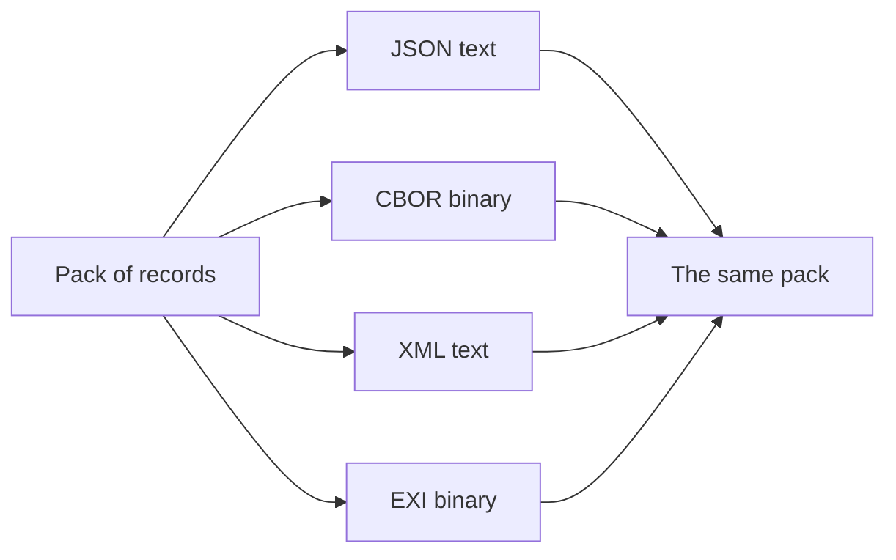

# SenMLFormat.jl

SenMLFormat reads and writes sensor readings in Julia. This manual shows you how,
one short example at a time.

The format is **SenML** (Sensor Measurement Lists,
[RFC 8428](https://www.rfc-editor.org/rfc/rfc8428)). SenML is a small, standard
way for a device to report what it measured: a list of
[records](@ref "Record"), each with a name, a value, and maybe a unit and a time.
A thermostat, a water meter and a web app can all agree on it without sharing
any code.

The same list can be sent in four formats. SenMLFormat reads and writes all of
them from one data model:



SenMLFormat is the Julia version of [rsenml](https://github.com/nhenehan/rsenml).
It writes the same bytes in every format and gives the same verdicts on the same
test data.

## Installation

SenMLFormat needs Julia 1.10 or newer. In the Pkg REPL (press `]`):

```
pkg> add SenMLFormat
```

or with `using Pkg; Pkg.add("SenMLFormat")`. It brings in
[EXIFormat](https://github.com/nhenehan/EXIFormat.jl) for EXI.

## Quick start

```@example home
using SenMLFormat

pack = Pack([
    Record(bn = "urn:dev:mac:0024befffe804ff1:", bt = 1.7e9, n = "supply-air", u = "Cel", v = 12.8),
    Record(n = "return-air", u = "Cel", v = 24.1),
    Record(n = "compressor", vb = true),
])
for media in (SENML_JSON, SENML_CBOR, SENML_XML, SENML_EXI)
    bytes = SenMLFormat.encode(media, pack)
    @assert SenMLFormat.decode(media, bytes) == pack
    println(content_type(media), ": ", length(bytes), " bytes")
end
```

## What you will learn

Each chapter of the manual follows one small script in `examples/basics`, from
easiest to hardest:

1. **Your first pack**: build a pack, write it as JSON and read it back.
2. **Choosing a format**: the eight media types, their sizes and CoAP numbers.
3. **Base fields and resolving**: how records share names and times, and how to
   get full names and absolute times out.
4. **Checking packs**: what the RFC's rules refuse, and the stricter option.
5. **Streaming with SenSML**: writing and reading one record at a time.
6. **When things go wrong**: the errors you can get back.

Every script has a Rust twin in rsenml's `examples/basics` with the same data.

## Where to go next

- The **Manual** starts with [Getting started](manual/getting-started.md).
- The **API reference** documents every public name, starting with
  [Records and packs](api/model.md).
- [Where the RFC is unclear](appendix/rfc-choices.md) lists the choices made
  where RFC 8428 leaves room.
